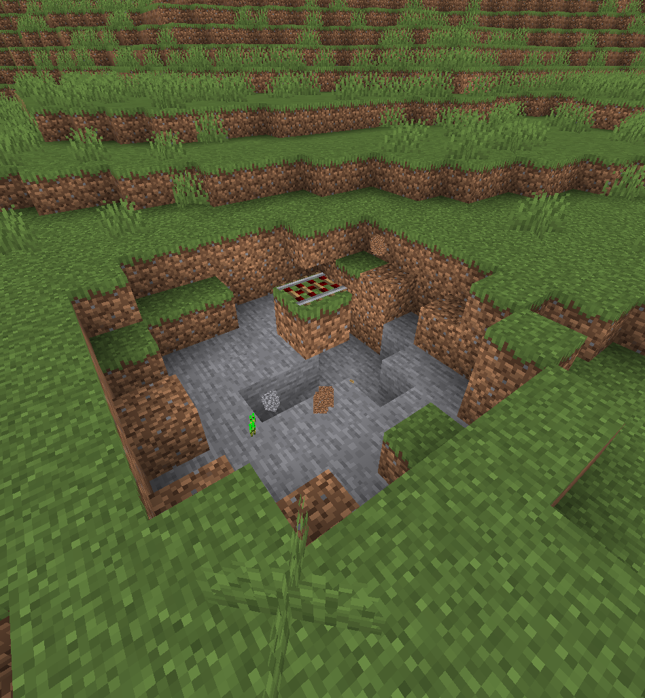
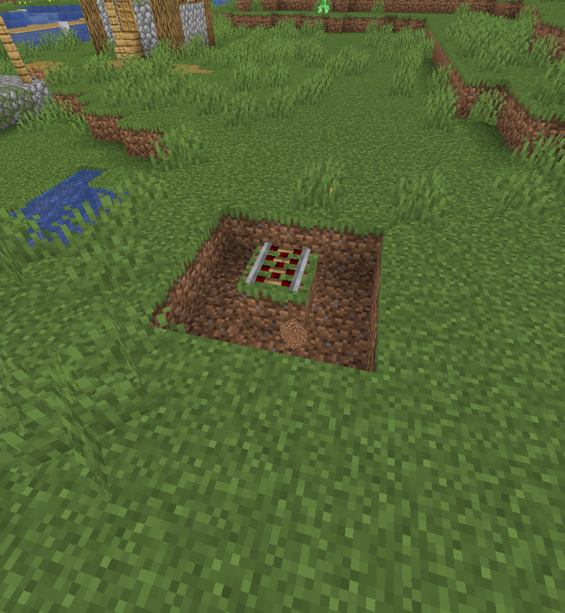
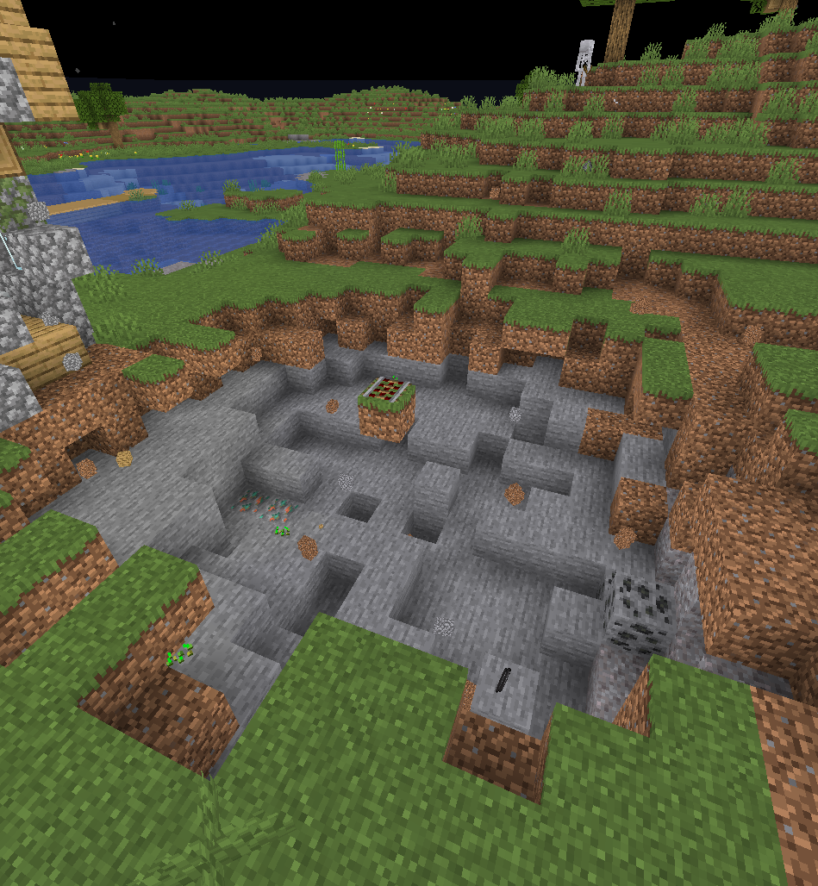

# Configurable Carts
Configurable Carts is a Minecraft plugin for 1.20.6+ that lets you configure the explosion power of all TNT Minecart entities.

## Configuration
Once you run the plugin for the first time, you should see a config file in plugins/ConfigurableCarts/config.yml with a default value of
```yaml
explosion-yield: 4.0
```

This is the default vanilla explosion radius, pictured below.

This is the explosion radius at 1.0:

And the radius at 10.0:

Note that changing the radius scales the damage done by the explosion as well.